# SMC3 R4


**A web dashboard, tuner, auto-tuner and diagnostics tool for DIY SMC3 motion seats, plus SMC3-compatible
firmware for the Arduino UNO R4 WiFi.**

The page lets you:

- watch every motor live;
- tune while you drive;
- let each motor tune itself;
- keep backups and per-game profiles;
- see the seat's real angles with an optional motion sensor, and the seat itself moving in a **3D view**;
- **level the platform** and make that SimHub's centre, then let each motor find how far it may go and save
  **travel limits, end stops and tilt limits** on the board;
- **move each motor by dragging its slider**, or send the whole seat back to center with one button;
- find out why when something goes wrong, and where the rig struggles under load;
- **update the firmware over WiFi**: pick the `.bin` from the Arduino IDE and press Install.

It knows two kinds of rig: **two front lifts plus a traction-loss motor** (motors 1 and 2 lift the front corners,
motor 3 is mounted horizontally and swings the rear left and right about a pivot at the front - the default), and
**three lifts**. Pick yours under Settings, Motor names.

SimHub keeps driving the rig over USB exactly as before. The page talks to the board over WiFi, so both run at
the same time. You can open it from any browser, including your phone.

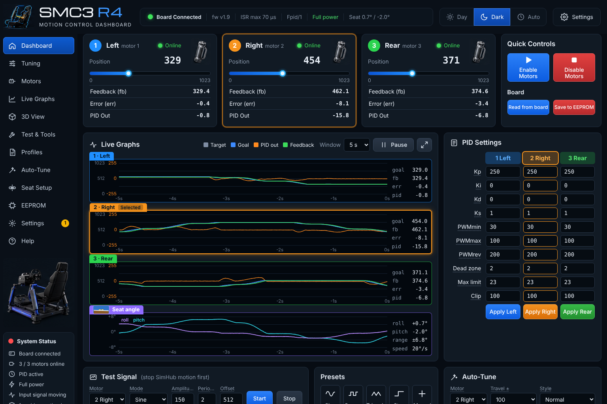

---

## What's in here

| Folder | What it is |
|---|---|
| [`firmware/SMC3_R4`](firmware/SMC3_R4) | Firmware for the **Arduino UNO R4 WiFi**. It speaks the SMC3 v0.70 protocol, so SimHub, SimTools, FlyPT Mover and SMC3Utils work unchanged. It adds a 4 kHz control loop, 14-bit pot readings, quiet 25 kHz PWM, target smoothing, a fixed PID, WiFi telemetry at 100 samples a second, an LED matrix that shows live motor bars and problems in words, a level trim with travel limits and end stops for each motor, a soft start, firmware updates over WiFi from the page, and an optional WT901C motion sensor with tilt limits for each direction. |
| [`scope/`](scope) | `smc3_scope.py`: the page server. It's one file using only the Python standard library, with a Dockerfile and compose file for a NAS or any PC. |
| [`tools/simboard.py`](tools/simboard.py) | A simulated rig. You can try everything without hardware, and inject faults (reversed motor, swapped wiring, glitchy pot and more). |
| [`firmware/SMC3_smooth`](firmware/SMC3_smooth) | The original SMC3 for the **UNO R3**, with target smoothing and the PID fixes, for anyone staying on an R3. |
| [`docs/`](docs) | Screenshots, the [protocol](docs/PROTOCOL.md), the [diagnostics](docs/DIAGNOSTICS.md) file format and an [example diagnostics file](docs/examples/diagnostics-full-check.json). |

> ⚠️ **A motion rig can hurt you.** It moves a person with motors strong enough to lift them. Test with the seat
> empty, keep hands and feet clear, and keep a hand near the motor power switch whenever you test, tune or flash
> new firmware. The safety cutoff in the firmware is a last resort, not a guarantee.

---

## A tour

### Dashboard

Each motor has a card showing where it is being sent and where it really is (the green tick on the bar), its
error and its PID output. The live graphs show, per motor:

- **Target**: what SimHub asks for.
- **Goal**: the target after the firmware's smoothing.
- **Feedback**: where the pot says the motor is.
- **PID output**: the drive sent to the motor.

Good tuning means the green line sits on the blue one. Click a motor, or choose one in a menu, and it is
highlighted everywhere: card, graph, PID column, test signal and auto-tune.

**Move a motor by hand (firmware 1.9): drag its knob.** The motor follows at up to 200 counts/s, easing in and out,
and never goes past its Clip window or travel limits (hatched on the track). A thin line marks where it is going.
Arrow keys on a selected knob move it 5 counts, with Shift 25. **Quick Controls, Return to center** sends every
motor back to its neutral position (SimHub's 0: the level seat with the rear centred), gently.

While the page moves the motors, it **has the seat**: the board ignores SimHub's position commands, and the status
bar says so. **Resume SimHub** gives the seat back. The page also lets go when the board restarts, when the page
server stops, or when auto-tune, a test signal, Seat setup or the full check starts. A motor that runs away from
where it is sent (wired backwards) is switched off at once; one that sinks, is stuck or falls behind is held where it
is.

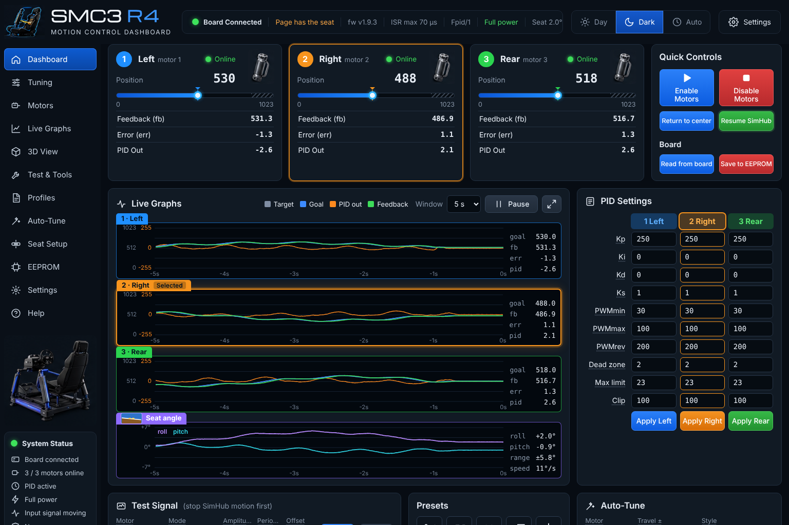

**Day, Dark and Auto** (which follows your computer):

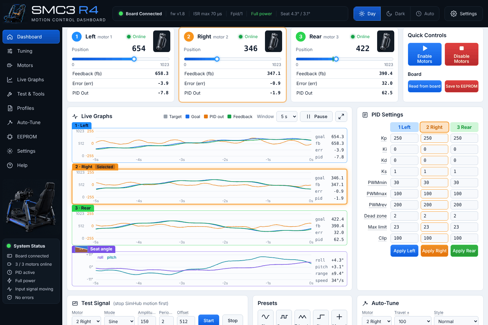

**Every control explains itself.** Hover over any setting, button or status item to see what it does on the rig,
what too low and too high feel like, and where to start.

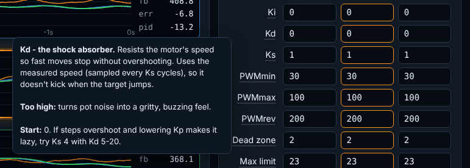

### Motors and live graphs

The expand button opens the graphs full width; pressing it again returns to the page you came from.

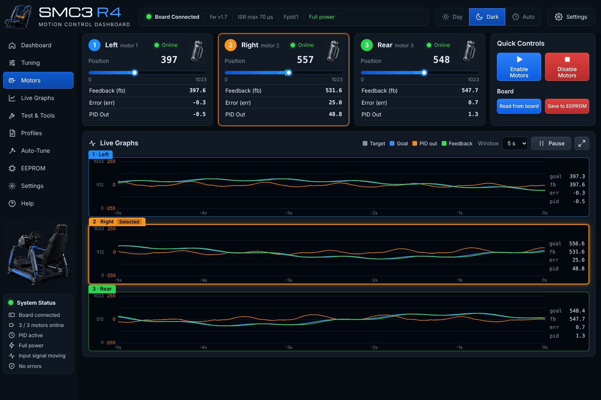

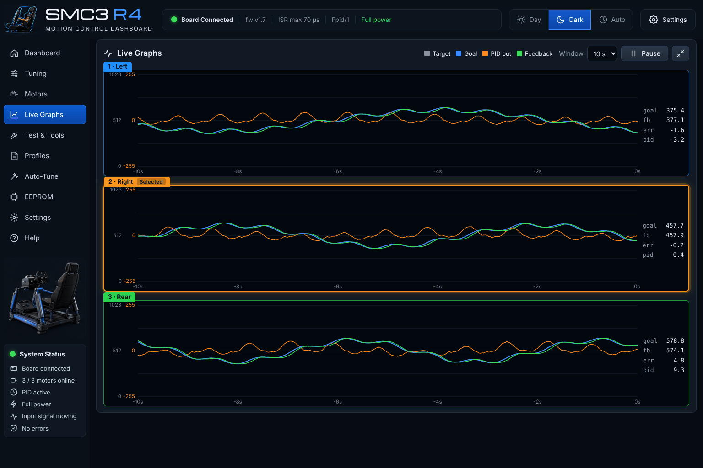

### Seat angle (motion sensor)

With a WitMotion **WT901C** on the seat, wired to the board (see [Hardware](#hardware)), Live Graphs gets a **Seat
angle** chart: roll and pitch in real degrees, the range the seat has reached, its fastest movement, and a small
horizon. A smooth slope while the seat moves is good; steps, wobbles, or a slope that slows down in one direction
show load, play or flex.

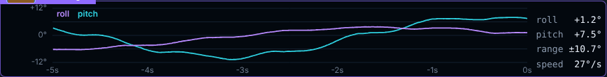

### 3D view

The seat in a sci-fi cockpit, moving live. With the motion sensor it shows the seat's real attitude; without one,
an estimate from the motor positions. On a traction-loss rig the two front actuators lift the front corners through a
yoke, and the horizontal rear actuator slides the rear left and right, so the seat swings about the pivot at the
front; how far it turns comes straight from motor 3's pot, so it moves exactly with the rig, and an arc on the floor
shows the rear's travel limits. (On a three-lift rig the actuators sit where Seat setup found each motor acts.) The
actuators glow brighter the harder they drive; a glowing outline shows where the motors are being sent whenever the seat lags behind.
Around it: the angles and the rear's turn, the sensor's gyro and acceleration, the actuators' positions, the sensor's
state and an attitude indicator with the tilt limits. Drag to turn it, scroll to zoom, or pick a camera (**Rig**
looks at the mechanics from low down at the back); it also goes full screen. The 3D engine (three.js) is built into the page server, so it works without internet access.

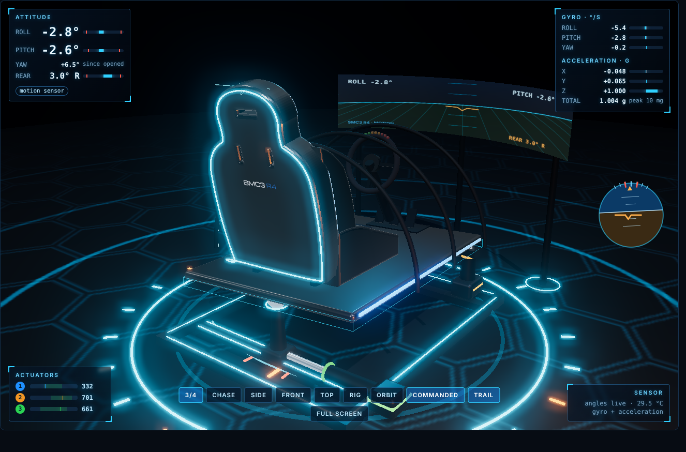

| Rig | Side |
|---|---|
| 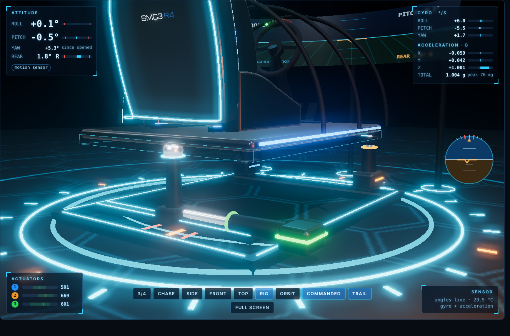 | 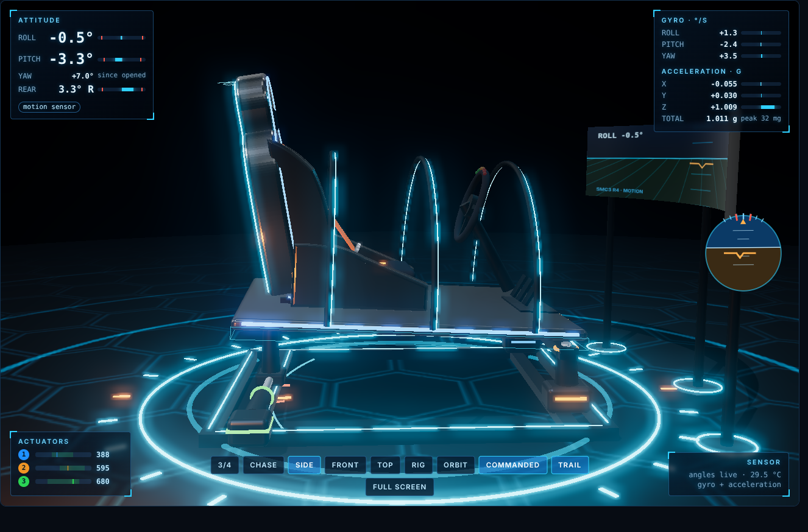 |

### Seat setup

**Level first, then the limits.** Seat setup (firmware 1.9) does in a couple of minutes what used to take an
evening with SMC3Utils:

1. **Level the platform.** With the motion sensor, press **Level automatically**: each motor moves a little to learn
   how it tilts the seat, then the page moves them until the sensor reads level, choosing the level position nearest
   the middle of every motor. Without the sensor, nudge the motors with a spirit level on the seat. Whatever you
   accept becomes **SimHub's centre**: the board adds a level trim to every position SimHub sends, and the seat
   powers up level. On a traction-loss rig only motors 1 and 2 level the seat: you **centre** motor 3, the rear
   slide, so the seat points straight ahead, and tell the page which way the rear went for +10.
2. **Find how far each motor may go.** Say how far the seat may tilt each way (and, with traction loss, how far it
   may turn). Each motor moves slowly away from level, both ways, and stops by itself at that tilt - the rear slide
   at that turn, measured by the sensor - when it **pushes against something**, at the end of its Clip window, or
   when you press **Stop** (or the space bar).
3. **Check and save the limits.** From what was found the page suggests **travel limits** (the board never sends a
   motor past them, whatever SimHub asks), **end stops** (a motor that gets past one anyway is switched off) and
   **tilt limits** for each direction (every motor stops). A picture shows where the seat can tilt inside them;
   front up and down usually need several motors at once, so the travel can be narrowed until no combination goes
   further than you allow. For the rear slide it shows how far the seat turns each way inside its travel limits.

While Seat setup is open the board ignores SimHub's positions, so SimHub can stay running; **Cancel** puts
everything back. Auto-tune, the test signal and the full check stay inside the travel limits afterwards.

| Level | Limits | Saved |
|---|---|---|
| 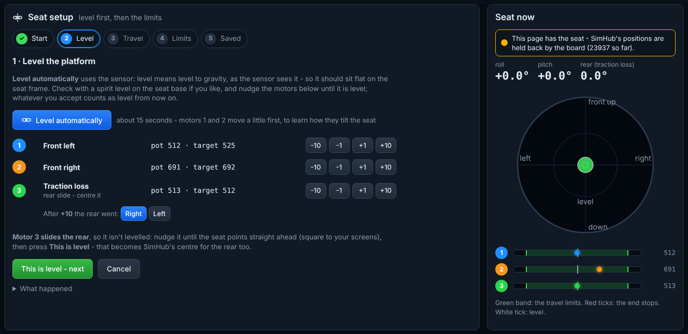 | 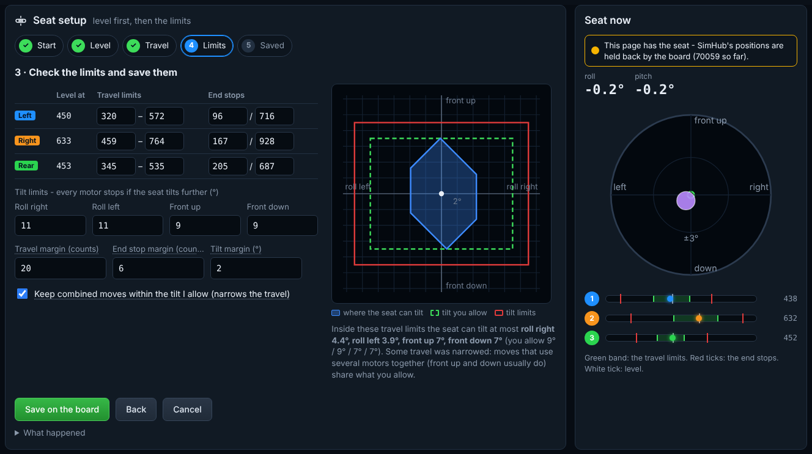 | 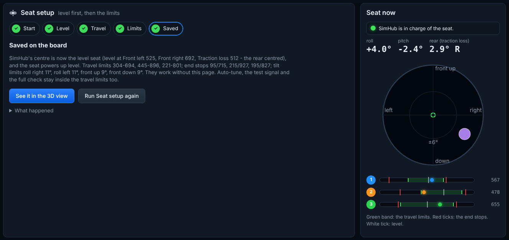 |

### Tuning

Every SMC3Utils setting is here, per motor: Kp, Ki, Kd, Ks, PWMmin, PWMmax, PWMrev, dead zone, the safety
cutoff ("Max limit") and Clip. You also get the loop divider, the PWM frequency, and, with firmware 1.6 or newer,
**target smoothing** and a **max speed** cap.

**Apply** changes a motor live. Nothing is stored on the board until you press **Save to EEPROM**.

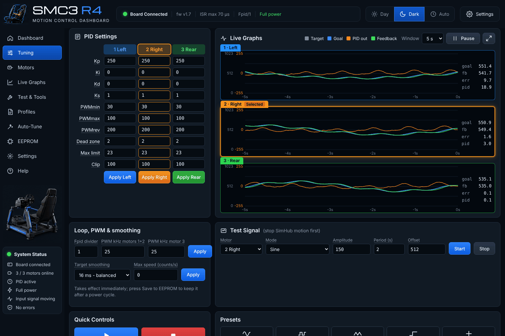

### Test signals

Drive one motor from the page with a sine, square, triangle or step, or hold it at a position. Use this to see
overshoot and lag before you touch a game. Stop SimHub's motion output first.

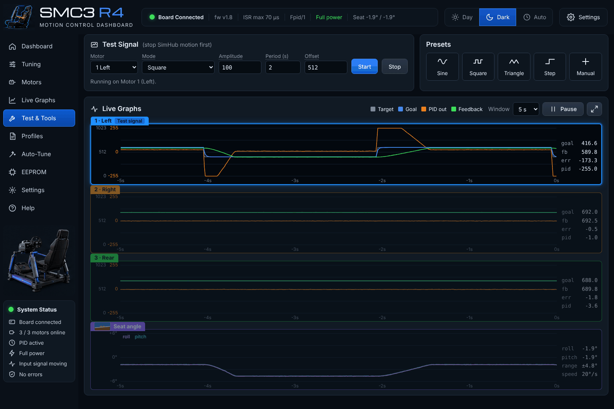

### Auto-tune

Auto-tune works on one motor at a time and tests it **both ways**: up and down for a lift, left and right for the
rear slide. Every test goes **out and back from where the seat starts**, the way you'd move a knob on the
dashboard: up, back to the start, down, back to the start (right, back, left, back for the rear slide). So the seat
never goes further than the test travel from where it was, and each direction is measured going away from the start
and coming back to it.

1. It measures the pot noise (dead zone), and the smallest drive that moves the motor each way (PWMmin).
2. It measures the motor's top speed each way with one quick move. Every test after that is a **gradual move** at
   60% of the slower way's top speed, easing in and out, so the motor can follow it as it follows a game.
3. It raises Kp step by step until the motor follows within the style's lag target both ways, or starts to
   overshoot.
4. It checks that small, sharp, kerb-sized steps (±30 counts from the start) stay calm.
5. It adds Ki and Kd only if they clearly help.

Each direction is judged on its own, and the log and the result show both. The board has one set of values per
motor, so the worse direction decides.

**Who's in the seat while it tests:**

- **Nobody**: tune with the seat empty and enter your weight, and auto-tune allows for it. It sets a stricter
  overshoot limit and a stiffer Kp, runs slower test moves, and keeps a little Ki. Then press **Check** with you in
  the seat: it tests the current values both ways, changes nothing, and says what to change.
- **Me**: Start gives you 15 s to get in. Stop, Space or Esc ends it at once.

**Auto-tune live** shows each test as gauges:

- how far the motor trails the move (lag), overshoot, settling, how far short it stops, ringing, and how much of
  PWMmax it takes;
- one needle per direction, with a coloured band for what's good.

The same card shows pot noise, the minimum drive and top speed each way, and the Kp sweep as two small charts
that scale to the results; the tabs switch the second one between overshoot, off by and settle time.
**Copy** puts the whole log and the result on the clipboard.

With the motion sensor, auto-tune also watches the **seat**: the seat's own overshoot and ringing count, so it
won't pick a Kp that keeps the motor calm but makes a flexing frame bounce.

There are three styles: **Gentle**, **Normal** and **Firm**. It stops by itself if SimHub moves the rig or
anything looks wrong, such as the motor moving the wrong way or running away. Nothing is saved until you press
Save to EEPROM, and **Revert** undoes it.

It measures the pot's noise first, and every limit that judges "it moved" or "it holds still" allows for it, so a
noisy pot doesn't look like a motor going the wrong way or ringing. A motor is only called wired backwards when it
goes the wrong way **both** ways: a seat that sinks under its weight while the drive is still too weak goes the
wrong way one way only. If it does stop for safety, that motor is switched off with its previous settings back.

| Checklist first | Running | Result |
|---|---|---|
| 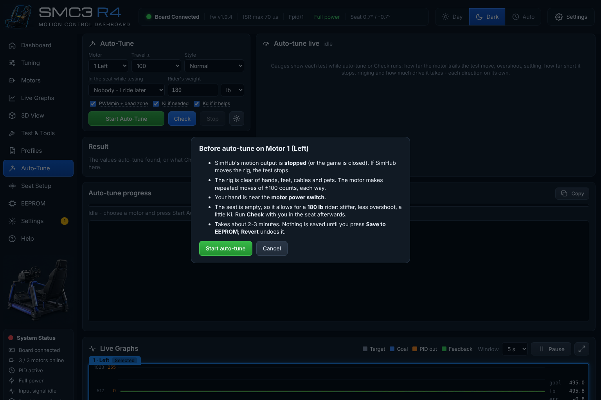 | 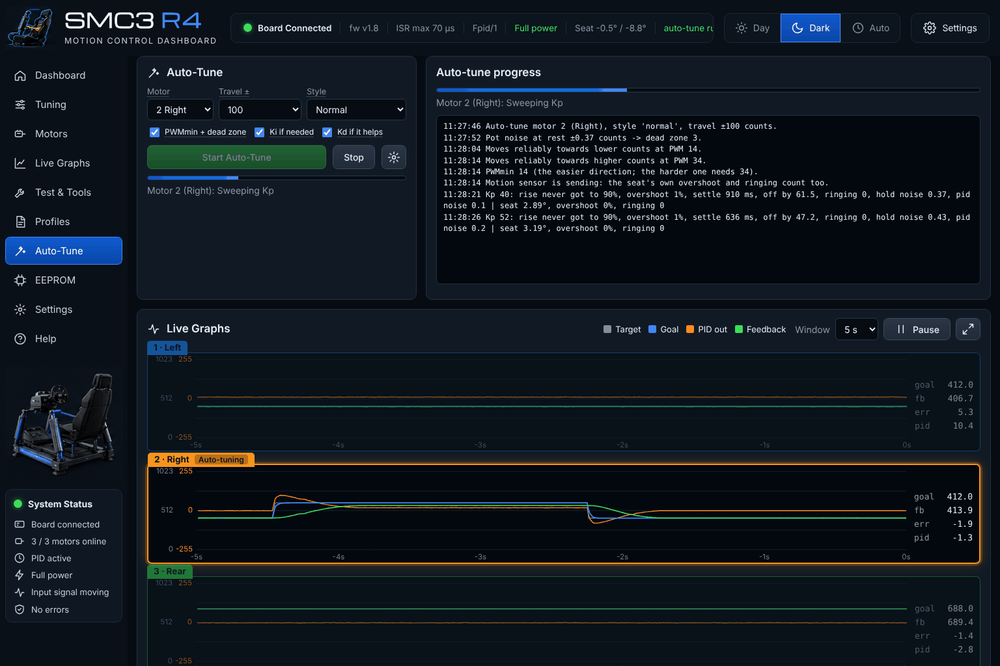 | 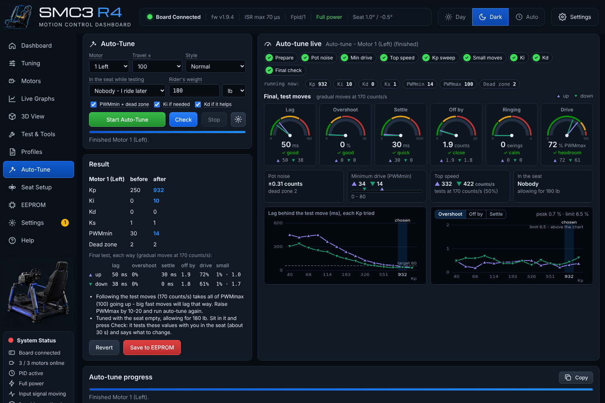 |

### Recommended starting points (profiles per kind of sim)

What feels right for circuit racing is wrong for a flight simulator. Each recommendation starts from **your own**
settings (ideally after auto-tune) and adjusts how firm, damped, fast and smooth the rig feels for that kind of
sim. It also lists the **SimHub settings** that matter most for it. You see a before-and-after table of every
change before anything is applied. Apply it, save it as a profile, or both.

| | Kp | Ki | Kd | PWMmax | Dead zone | Smoothing | Max speed |
|---|---|---|---|---|---|---|---|
| **Circuit racing** | as tuned | as tuned | as tuned | as tuned | as tuned | 8 ms | off |
| **Rally & off-road** | ×1.15 | as tuned | at least 10 (Ks 4) | +15 | as tuned | 4 ms | off |
| **Flight** | ×0.75 | at least 15 | as tuned | −15 | +1 | 32 ms | 1500/s |
| **Space & sci-fi** | ×0.85 | at least 10 | as tuned | −10 | +1 | 16 ms | 2000/s |
| **Trucks & cruising** | ×0.8 | at least 5 | as tuned | −10 | as tuned | 32 ms | 1500/s |

<table>
<tr><td><b>Circuit racing</b>: GT, formula, touring. Crisp and detailed, your tuning as it is.<br>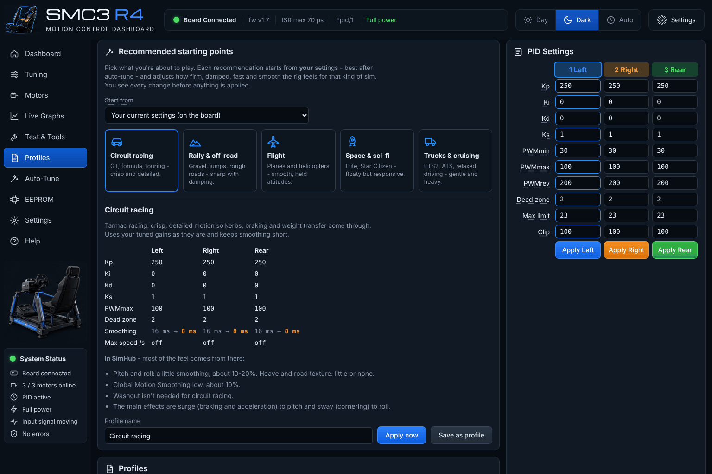</td>
<td><b>Rally &amp; off-road</b>: gravel, jumps, rough roads. Sharper, with damping.<br>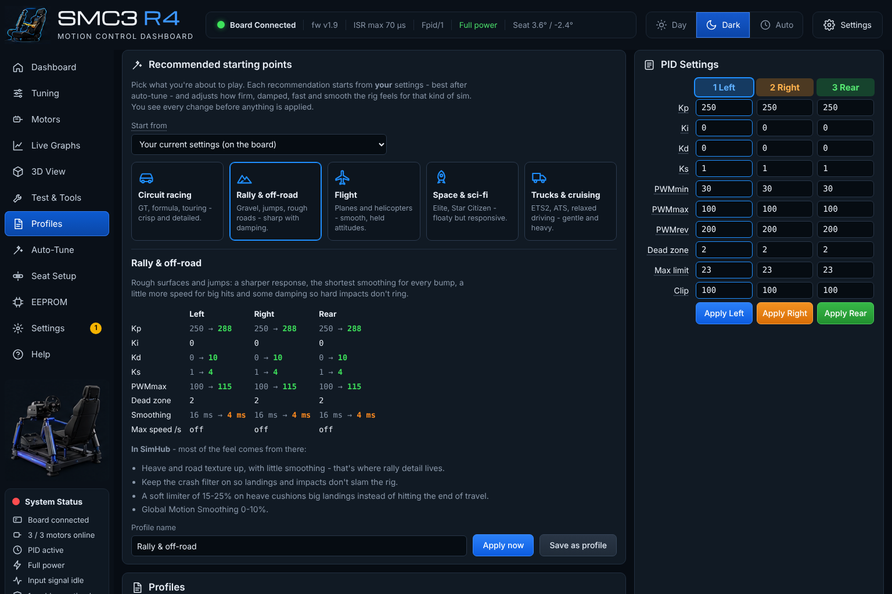</td></tr>
<tr><td><b>Flight</b>: planes and helicopters. Smooth, held attitudes, with washout in SimHub.<br>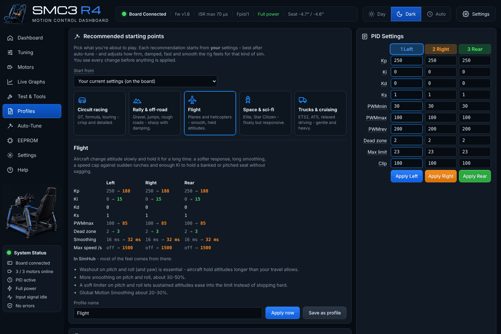</td>
<td><b>Space &amp; sci-fi</b>: Elite, Star Citizen. Floaty but responsive.<br>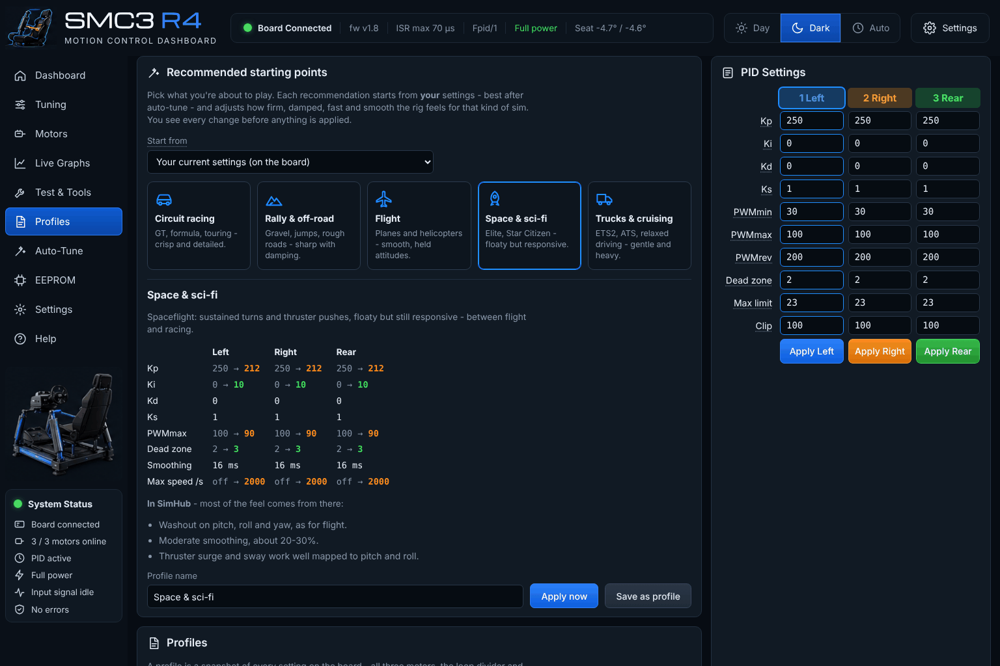</td></tr>
<tr><td><b>Trucks &amp; cruising</b>: ETS2, ATS, relaxed driving. Gentle and heavy.<br>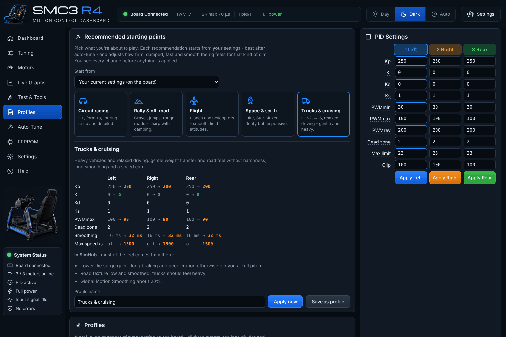</td>
<td><b>Profiles</b>: save every board setting under a name, one per car or game, and load it in a click.<br>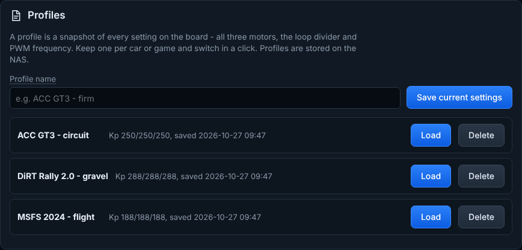</td></tr>
</table>

### EEPROM and backups

Every Save to EEPROM, and every bigger change (loading a profile or recommendation, starting auto-tune,
switching backups), keeps a copy of the settings on the NAS. **Switch to** puts a backup on the board live;
**Switch + save** also stores it in EEPROM. The backup that matches the board right now is marked.

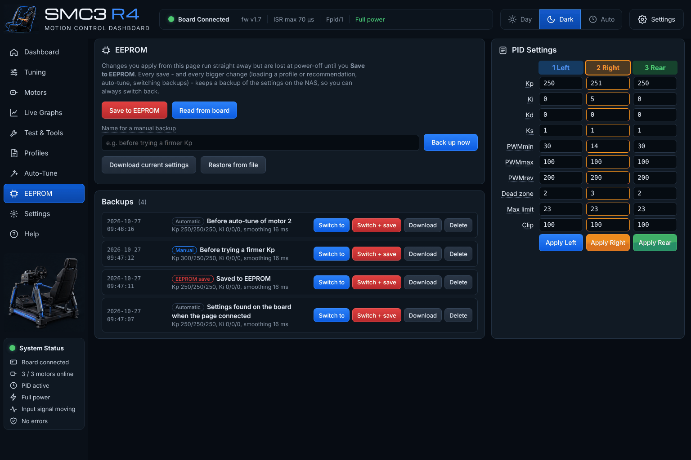

### Settings and motor names

In Settings you set:

- the board's address, plus a **Find board on network** scan and auto-find if the address changes;
- the theme;
- **how many motors you use** (1 to 3). Unused motors can also be switched off on the board.

Under **Motor names** you can call each motor by where it sits: Front left, Front right, Traction loss, or anything
you like. The names show everywhere in the page and in diagnostics, always next to the number, because the wiring,
SimHub's outputs and the LED matrix codes go by number.

The same card says what **motor 3** does:

- **Slides the rear left / right (traction loss)**, the default: motors 1 and 2 lift the front corners, and motor 3,
  mounted horizontally, swings the rear about a pivot at the front. Also which way the rear goes for higher numbers
  (Seat setup and the full check ask you).
- **Lifts the seat, like motors 1 and 2**: three lifts.

Seat setup, the full check, auto-tune, the recommendations and the 3D view follow it.

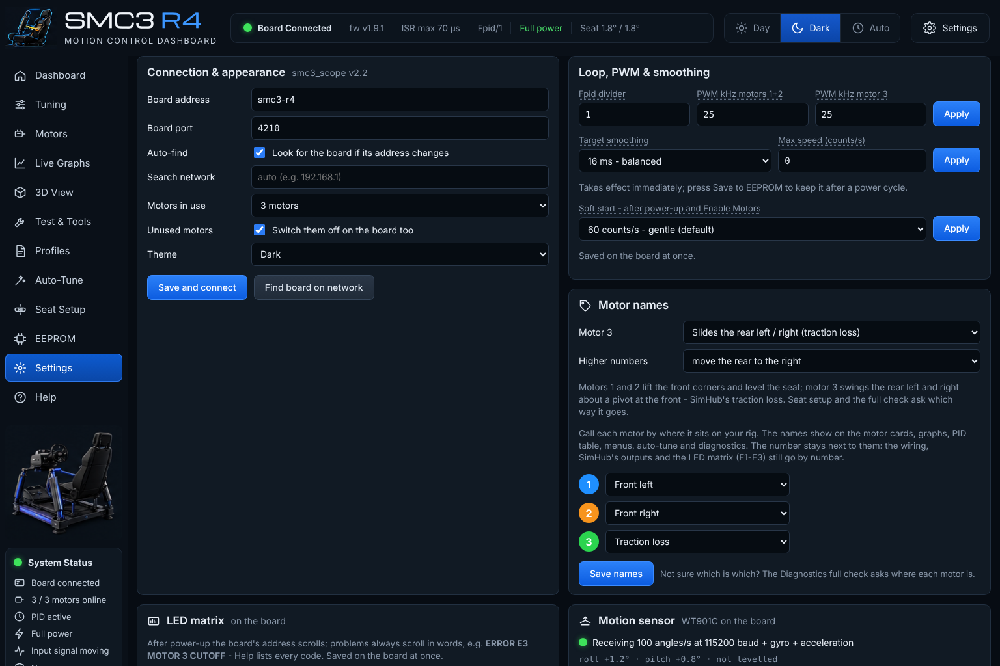

**LED matrix** and **Motion sensor** (firmware 1.8) are set here too, and saved on the board at once:

- what the matrix shows;
- switching the sensor on;
- how it is mounted;
- **Level now**;
- the **tilt limits** for each direction (firmware 1.9; one for all with 1.8), which stop every motor if the seat
  tilts further than it should;
- **Set up the sensor**: 100 readings a second with gyro and acceleration (it leaves the factory at 10).

The status line says whether the sensor is found, at what baud rate, how fast it sends and whether gyro and
acceleration arrive.

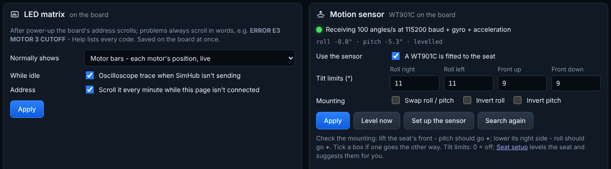

**Firmware update** (firmware 1.9.2): install new firmware over WiFi - no USB cable, and SimHub can stay open.

1. In the Arduino IDE, open the new `SMC3_R4.ino` and choose **Sketch, Export Compiled Binary**. The WiFi name and
   password may stay as placeholders: the board remembers the ones it last joined with.
2. In the page, choose that `.bin` (in the sketch's `build/arduino.renesas_uno.unor4wifi` folder) and press
   **Install**, with the seat empty and SimHub's motion output paused.

The page checks the file first (an SMC3_R4 build for the UNO R4 WiFi, which version) and converts it to the board's
update format. The board switches the motors off, its WiFi module downloads the file, checks it and programs the
board - the same way a USB upload does - and the board restarts; the seat creeps back with the soft start and the
page confirms the new version. If anything fails before programming, the old firmware keeps running and the card
says why. The first install of it (1.9.3 or later; 1.9.2 didn't compile) goes over USB, and the WiFi module needs its
own firmware 0.4.0 or newer (Arduino IDE, Tools, Firmware Updater).

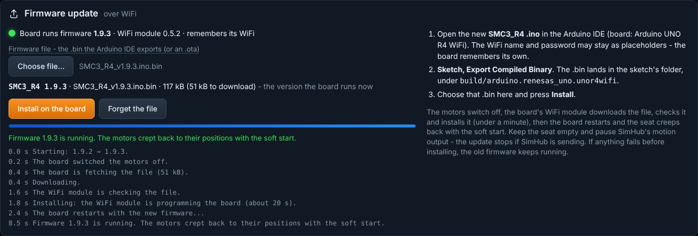

### LED matrix

The board's 12x8 matrix shows one thing at a time, readable from across the room. These previews are rendered from
the firmware's own drawing code:

| Power-up: the address | Motor bars | Seat horizon (sensor) | Idle | A problem |
|---|---|---|---|---|
| 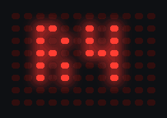 |  |  | 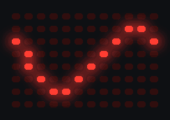 |  |

- **Motor bars:** each motor's position, live. A dot blinks where a motor should be when it falls behind. A dash
  at the bottom means it's switched off on purpose.
- **Problems** scroll in words, again and again while they last: `ERROR E3 MOTOR 3 CUTOFF`, `ERROR E4 TILT LIMIT`,
  `ERROR E9 NO WIFI` and so on. The page's Help explains every code and what to do:

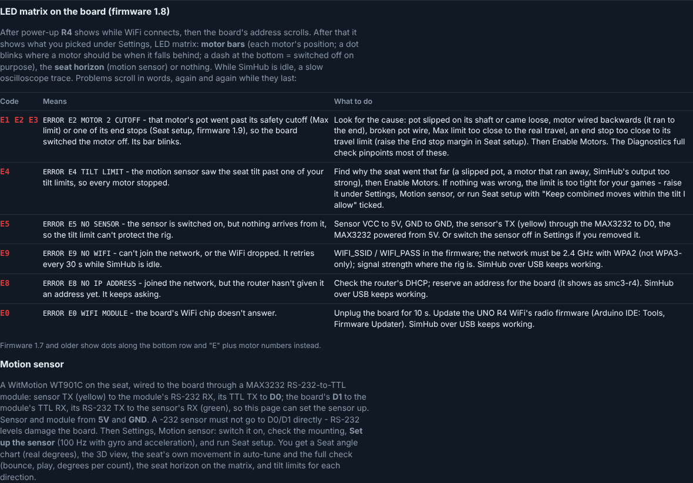

### Diagnostics

For when something isn't right: a motor going the wrong way, sudden jerks, a motor that won't move, the rig
restarting. Describe the problem, run a check, and download **one self-describing file** to give to whoever
helps you. You can also upload it to an AI assistant such as Claude.

**Quick check:** nothing moves, and it's safe while SimHub runs. It reads every setting and compares it with
what's saved in EEPROM, reads the board's own counters, listens to the motors for 3 seconds, and adds everything
the page noticed while you drove.

**Full check:** moves each motor a little, one at a time, with the others switched off meanwhile. For each motor
it finds:

- which way the motor really moves;
- how much drive it needs to start moving each way;
- whether another motor moves instead, which means swapped motor or pot wiring;
- how it handles a small step with its own settings.

It also **asks you what you saw**: which way each corner went, and where it is on the seat - for the traction-loss
motor, whether the rear went left or right. That's the one thing sensors can't tell, for example whether the motion
will be upside down in games. A motor that moves the wrong
way is stopped at once and left off.

It also notes which way each lift's numbers run when its corner **sinks** under the seat's weight (drifting while
its motor is off, or sinking at low drive). Until you answer the question, auto-tune goes by that for up and down,
and the results warn when the two front lifts seem to run opposite ways (also when one needs clearly less drive one
way - the weight helps it down) - one of them would then move the wrong way in games. It also says when your answer
disagrees with how a corner sinks, so you can look again.

| Before it starts | "Watch now", then the question |
|---|---|
| 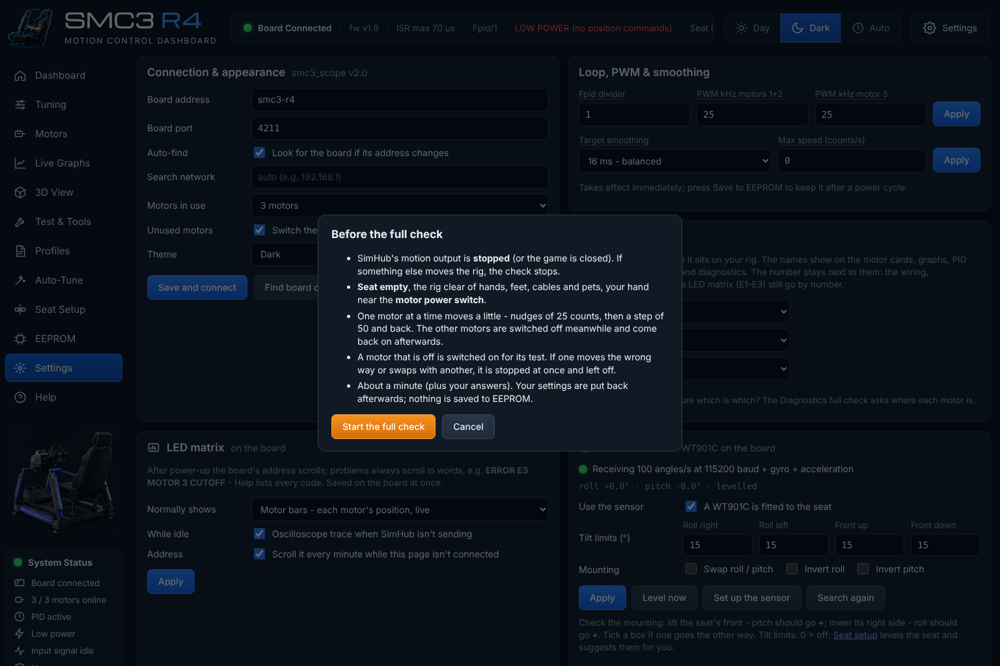 | 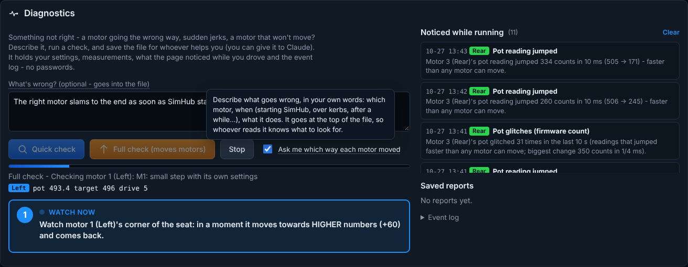<br>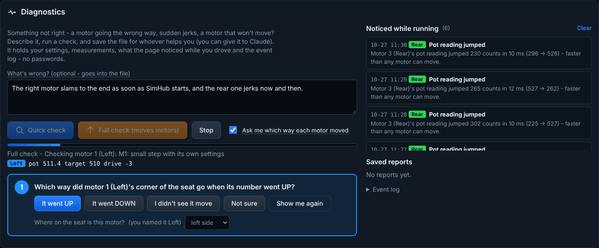 |

The results come in plain words, each with **what to do**, naming the wire and pin where it can:

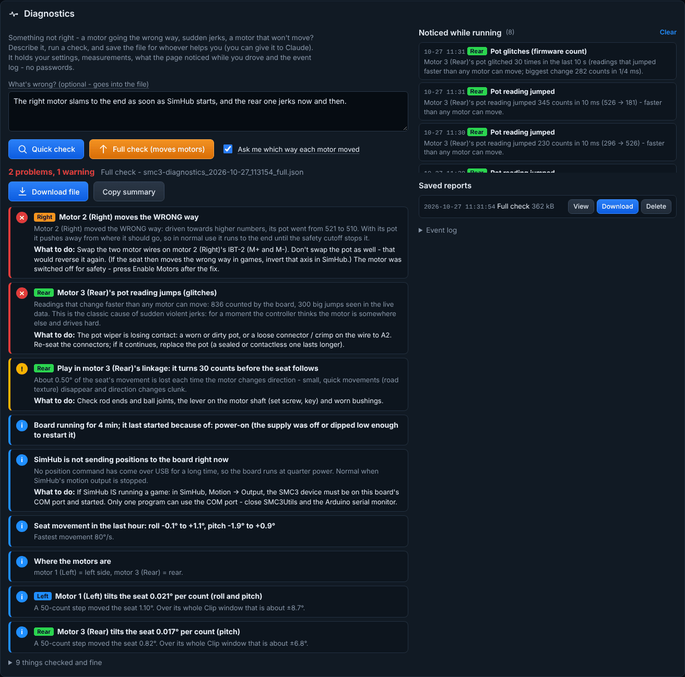

**A watcher that never sleeps.** While you drive, the page notices problems by itself:

- pot readings that jump faster than any motor can move (the classic cause of violent jerks);
- a motor moving away from its target;
- a motor pushed hard that doesn't move;
- hunting at rest;
- motors switching themselves off, including the tilt limit;
- board restarts;
- gaps in the data;
- the motion sensor going quiet.

**Where the rig struggles.** While SimHub drives, the page also keeps a **load map** for each motor: in eight
bands across its travel, and in each direction, how far it runs behind and how often it's at full power. Lifting a
heavy driver shows up as one direction falling behind at full power while the other keeps up. The quick check names
the band and, with the sensor, the seat angles there:

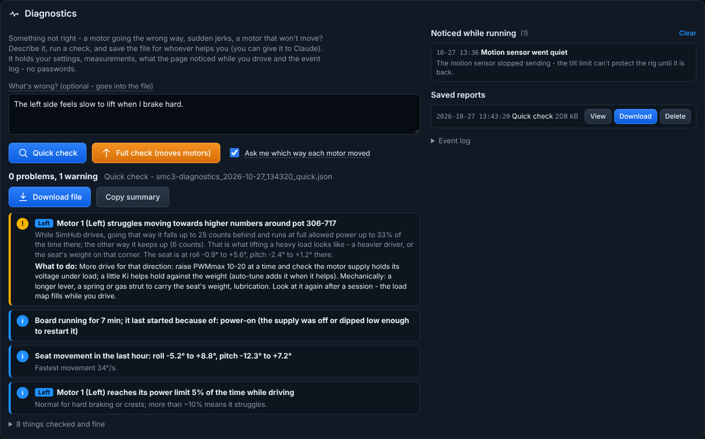

With the motion sensor, the full check also measures what the **seat** does on each step: how many degrees each
motor tilts it (the traction-loss motor: how far it turns it), whether it **bounces** after the motor stops (flex),
and whether there is **play** in a linkage. A lift that turns the seat, or a traction-loss motor that tilts it, is
flagged: the wiring or the setting doesn't match the rig.

Each one keeps a few seconds of data from before and after. A badge and a System Status line tell you about it,
and the **event log** shows what led up to it.

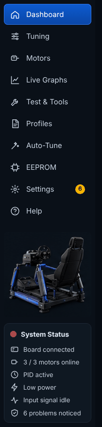 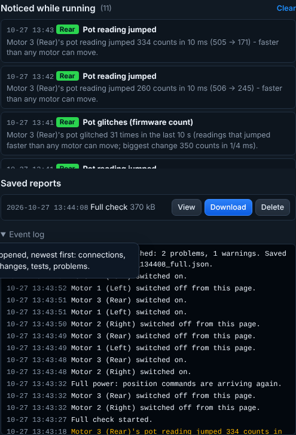

See [docs/DIAGNOSTICS.md](docs/DIAGNOSTICS.md) for every check and the file format, and
[docs/examples/diagnostics-full-check.json](docs/examples/diagnostics-full-check.json) for a real file from the
simulated rig with a reversed motor, a glitchy pot and play in a linkage.

### On a phone

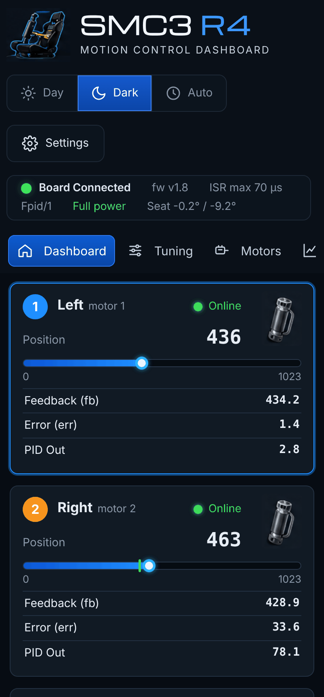 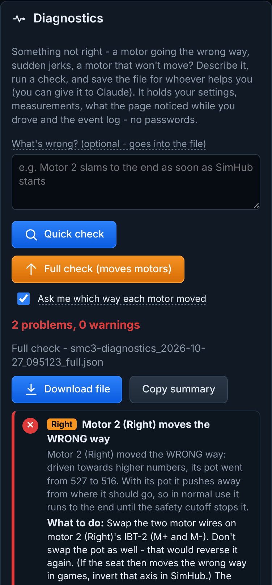

The Help section in the page sums everything up, including every LED matrix code.

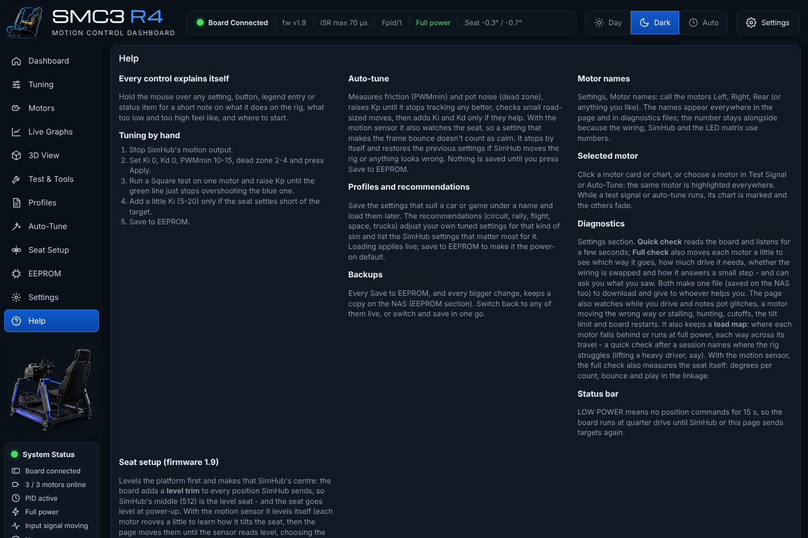

---

## Hardware

- **Arduino UNO R4 WiFi**. The firmware is written for it: WiFi, LED matrix and the RA4M1's timers.
- Motor bridges: **IBT-2 / BTS7960** (`MODE2`, the default), or a bridge with PWM plus two direction pins
  (`MODE1`).
- Up to three DC motors with feedback pots, such as worm-gear wiper motors on crank arms or linear actuators, and
  a motor supply that suits them. Typical layouts: two lifts at the front plus a horizontal **traction-loss** motor
  sliding the rear (SimHub's 2DOF + traction loss), or three lifts.
- Optional: a WitMotion **WT901C** motion sensor on the seat. The -232 model connects through a MAX3232 module
  (RS-232 to TTL) to D0 and D1 - **never straight to the pins**: RS-232 levels damage the board. It gives seat
  angles, automatic levelling, tilt limits, the 3D view, and seat measurements in auto-tune and diagnostics. It is
  set up from the page.

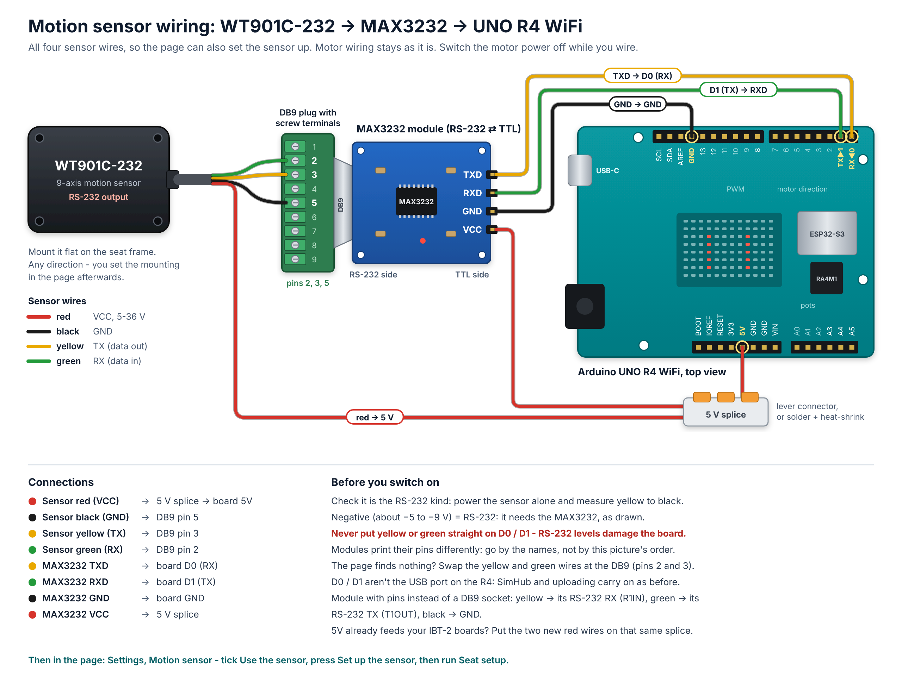

Wiring is the same as the original SMC3 on an UNO, so existing rigs need no changes:

| | PWM | Bridge pins (ENA / ENB) | Feedback pot (wiper) |
|---|---|---|---|
| Motor 1 | D9 | D2 / D3 | A0 |
| Motor 2 | D10 | D4 / D5 | A1 |
| Motor 3 | D11 | D6 / D7 | A2 |

The pots' outer pins go to 5 V and GND. For how each bridge input connects to an IBT-2, follow the original SMC3
wiring diagrams on xsimulator.net.

### Pot noise filter

Diagnostics counts **pot glitches**: readings that jump further in 1/4 ms than any motor can move. Most come from the
motor PWM getting into the pot wires, and each one makes the PID kick the motor for a moment. Firmware 1.9.4 holds
a glitch back in software (the board still counts them), and three small parts per pot at the Arduino stop most of
them reaching the board at all:

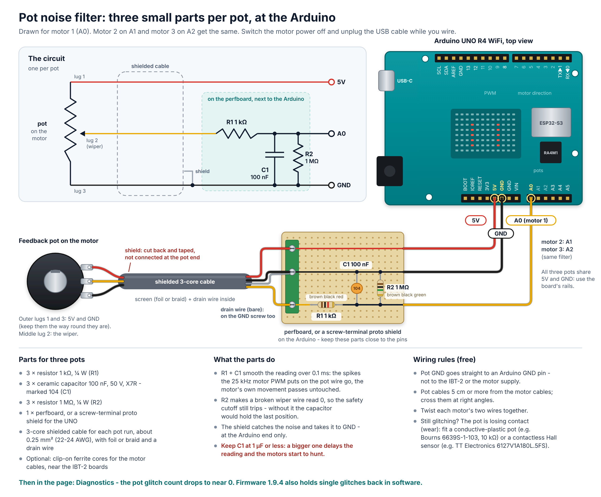

| Part (for three pots) | Where | What it does |
|---|---|---|
| 3 × resistor 1 kΩ, ¼ W (R1) | in the wiper wire, at the Arduino | with C1: a low-pass filter (0.1 ms) - the 25 kHz PWM spikes go, the motor's own movement passes untouched |
| 3 × ceramic capacitor 100 nF, 50 V, X7R, marked 104 (C1) | A pin to GND | |
| 3 × resistor 1 MΩ, ¼ W (R2) | A pin to GND | a broken wiper wire reads 0, so the cutoff still trips (otherwise C1 would hold the last position) |
| perfboard, or a screw-terminal proto shield | next to the Arduino | keeps the parts close to the pins |
| 3-core shielded cable, about 0.25 mm² (22-24 AWG), foil or braid with a drain wire | each pot run | the shield goes to GND **at the Arduino end only** |
| optional: clip-on ferrites | motor cables, near the IBT-2 boards | less noise from the motor wires |

Keep C1 at 1 µF or less: a bigger one delays the reading and the motors start to hunt. Wiring rules that cost
nothing: the pot GND goes straight to an Arduino GND pin (not to the IBT-2 or the motor supply), pot cables stay
5 cm or more from motor cables and cross them at right angles, and each motor's two wires are twisted together. A
pot that still glitches is losing contact (wear) - no filter fixes that: fit a conductive-plastic pot (for example
Bourns 6639S-1-103, 10 kΩ) or a contactless Hall-effect sensor with a 0-5 V output (for example TT Electronics
6127V1A180L.5FS), keeping its travel away from the ends of its range. The same drawing is in the page's Help.

## Getting started

### 1. Flash the firmware

1. In the Arduino IDE, install the board package **Arduino UNO R4 Boards** and select **Arduino UNO R4 WiFi**.
2. Open `firmware/SMC3_R4/SMC3_R4.ino` and put your **WiFi name and password** into `WIFI_SSID` / `WIFI_PASS`
   near the top. The board only does 2.4 GHz. Check `MODE2` / `MODE1` and the other options listed in
   [firmware/README.md](firmware/README.md).
3. Upload. At power-up the board's IP address scrolls across the LED matrix. Reserve it in your router.

From firmware 1.9.2 on, later versions can be installed from the page instead (Settings, Firmware update).

Your SMC3Utils settings stay in EEPROM in the same layout. If the board had none, the defaults are written.

### 2. Run the page

**With Docker** (a NAS or any PC):

```sh
git clone https://github.com/winreboot/smc3-r4.git
cd smc3-r4/scope
docker compose up -d --build
```

Then open `http://<that machine's IP>:8198`, go to **Settings** and enter the board's address (or press **Find
board on network**). Settings, profiles, backups and diagnostics are kept in `scope/data`. To keep them elsewhere,
for example on a Synology NAS, run:

```sh
mkdir -p /volume1/docker/smc3-scope-data
SMC3_DATA=/volume1/docker/smc3-scope-data docker compose up -d --build
```

**Without Docker** (Python 3.8 or newer, nothing to install):

```sh
python3 scope/smc3_scope.py --host 192.168.1.50 --bind 0.0.0.0 --web 8198
```

`--bind 0.0.0.0` makes the page reachable from other devices; without it, the page is on this machine only - and
the board can't fetch firmware updates from it.

### 3. SimHub

In SimHub, set the motion output to an **SMC3** device on the board's COM port, exactly as with an UNO R3. Only
one program can use the COM port, so close SMC3Utils and the Arduino serial monitor. The page never needs the COM
port. With a traction-loss rig, SimHub's traction-loss (yaw / slip) output goes to motor 3; if the rear swings the
wrong way in a slide (in a right-hand slide it should swing out to the left), tick Invert on that output.

### 4. Seat setup

Open **Seat Setup**: level the platform (by itself with the motion sensor), centre the rear slide if you have
traction loss, let each motor find its safe travel, and save. SimHub's centre is then the level seat, and the limits protect the rig whatever drives it.

### 5. Tune

Run **auto-tune** on each motor: seat empty first, with your weight entered. Then either **Check** with you in the
seat, or run auto-tune again with you in it. Try it in a game, and **Save to EEPROM**.

**Soft start** (firmware 1.9.1): after the rig has been off the seat may have ridden down a little. At power-up, and
when you press Enable Motors, each motor creeps back to its position instead of jumping there, then runs normally.
The speed (60 counts/s by default, or off) is under Settings, Loop, PWM & smoothing. Then
try the **recommendations** for the sims you play and save them as profiles.

## Try it without a rig

```sh
python3 tools/simboard.py 4210 --tuned &
python3 scope/smc3_scope.py --host 127.0.0.1 --port 4210
# open http://localhost:8080
```

The simulator speaks the same protocol as the firmware, using a worm-gear motor model with friction, lag and pot
noise. To see what the diagnostics find, add a fault:

| Option | What it simulates |
|---|---|
| `--reverse 2` | motor 2's wires swapped |
| `--swap-motors 1,2` / `--swap-pots 2,3` | channels mixed up |
| `--glitch 3` / `--noisy 2` | worn or noisy pot |
| `--dead 3` / `--slip 1` / `--oneway 1` | no motor power / pot slipped on its shaft / half a bridge dead |
| `--hunt 1` / `--pwmmax0 2` | unstable settings / PWMmax 0 |
| `--simhub` | a fake SimHub driving all three motors |
| `--layout lifts` / `--tl-left` | three lifts instead of front lifts + a traction-loss rear slide (the default) / the rear slide goes left for higher numbers |
| `--reboot-at 30` | the board restarting |
| `--fw 16` | older firmware behaviour |
| `--imu 100` (or `10`) | a WT901C on the seat, sending 100 (or the factory 10) angles per second; `--sensor-on` switches it on |
| `--flex` / `--slop 2:24` | a bouncy seat frame / 24 counts of play in motor 2's linkage |
| `--heavy 1` | a heavy load on motor 1: lifting needs much more drive, worse near the top |
| `--pot-noise 2:2.3` | motor 2's pot reads ±2.3 counts at rest, with the odd spike |
| `--sag 2` (`--sag-pull 0.2`) | motor 2's gearbox can be driven backwards: the seat sinks while the drive is weak (harder) |
| `--pot-glitches 2:80` | motor 2's pot wiper loses contact about 80 times a second (readings 16-40 counts off); `--no-potfilter` = firmware 1.9.3, whose PID sees every glitch |
| `--sag-high 1` | like `--sag`, but the weight pulls motor 1 towards higher numbers (a lift whose numbers run the other way) |
| `--load 82` | an 82 kg rider: the lifts need more drive going up and less going down, and every motor carries more weight |
| `--vmax 1000` | slower motors (counts/s at full drive; default 2200) |
| `--imu-lost-at 30` | the sensor goes quiet after 30 s |
| `--seat-tilt 1.6:-2.2` | the seat isn't level with every motor at 512 (for Seat setup) |
| `--stops 3:180:860` | motor 3 hits a mechanical stop at pot 180 and 860 |
| `--seat-setup` | start with a saved seat set-up (level trim, travel limits, end stops, tilt limits) |

## Compatibility

- The board answers like SMC3 v0.70 (`[ver]` returns 70), and the EEPROM layout is unchanged. SimHub, SimTools,
  FlyPT Mover and SMC3Utils see an ordinary SMC3.
- The page works with every firmware from 1.3 on. Newer firmware unlocks more:
  - 1.4: auto-tune, and Check;
  - 1.5: Disable Motors;
  - 1.6: smoothing settings;
  - 1.7: full diagnostics;
  - 1.8: the LED matrix in words, and the motion sensor;
  - 1.9: Seat setup (level trim, travel limits, end stops, tilt limits for each direction), gyro and acceleration
    for the 3D view, moving the motors from the page (page 2.4);
  - 1.9.1: soft start;
  - 1.9.2: firmware updates from the page, and the board remembers its WiFi;
  - 1.9.3: the same, and it compiles in the Arduino IDE (1.9.2 didn't);
  - 1.9.4: a pot glitch filter - a reading too far from the last one to be the motor is held back for up to 10 ms.

  See the [CHANGELOG](CHANGELOG.md).
- New commands are documented in [docs/PROTOCOL.md](docs/PROTOCOL.md). They go over WiFi; USB stays plain SMC3.

## Credits and licence

- **SMC3** by RufusDufus and the [xsimulator.net](https://www.xsimulator.net) community. The firmware here is a
  port and extension of SMC3 v0.70. Thank you.
- The **Michroma** font, SIL Open Font License 1.1 ([licence](docs/licenses/Michroma-OFL-1.1.txt)), is embedded
  in the page for the SMC3 R4 wordmark.
- **three.js** r160 (MIT, [licence](docs/licenses/three.js-LICENSE.txt)) is embedded in the page server for the 3D
  view.
- The seat logo, rig picture and motor icon come from the dashboard mock-up this project started from.
- Built with help from Claude (Anthropic).

Code in this repository: [MIT](LICENSE). The original SMC3 was shared freely without a stated licence; see the
note in [LICENSE](LICENSE).
