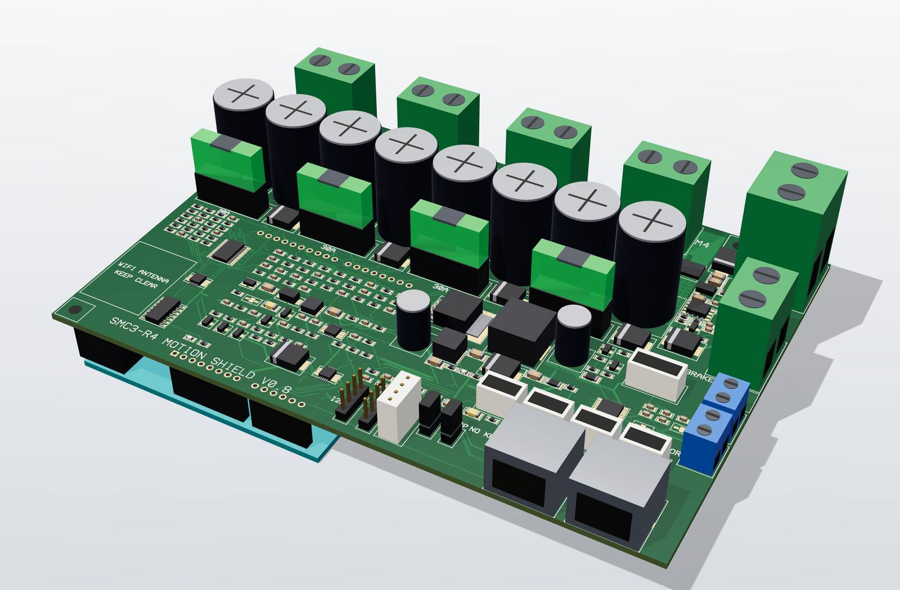
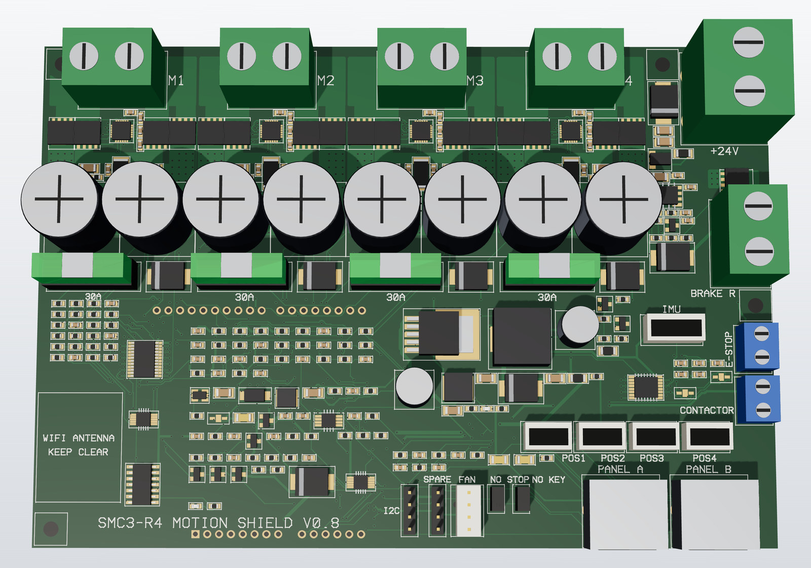
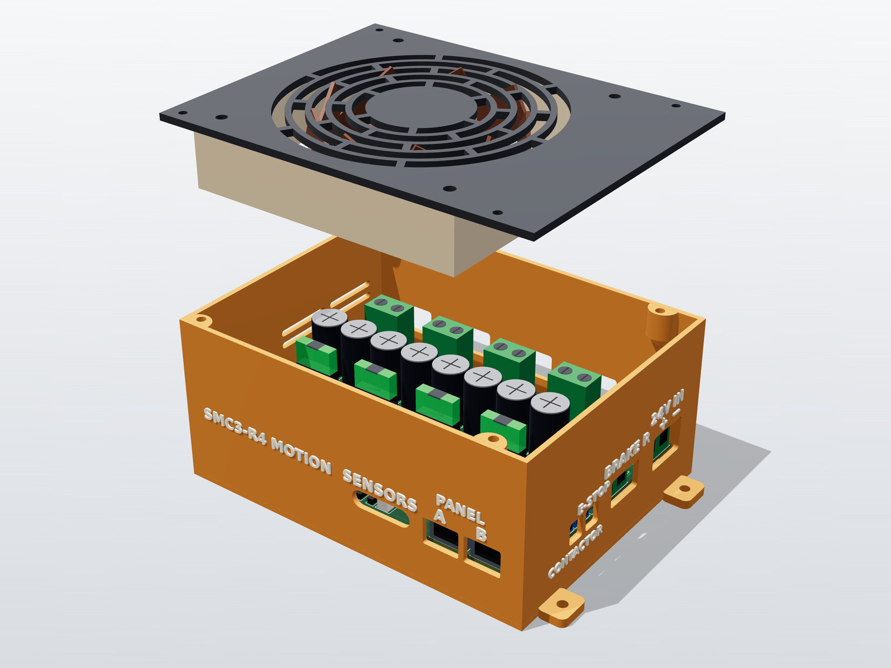
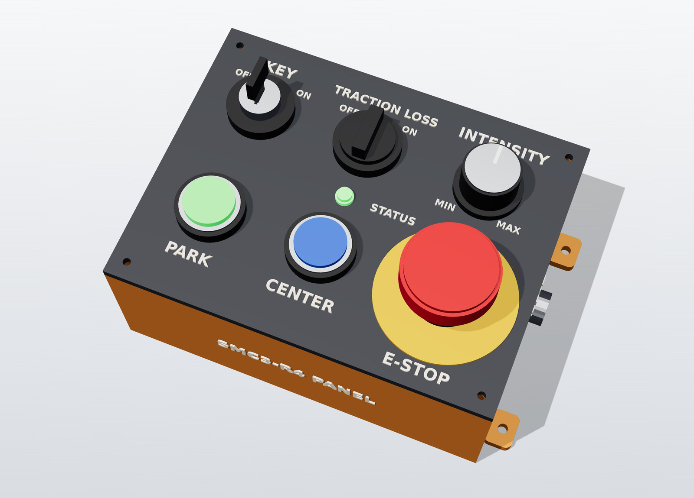
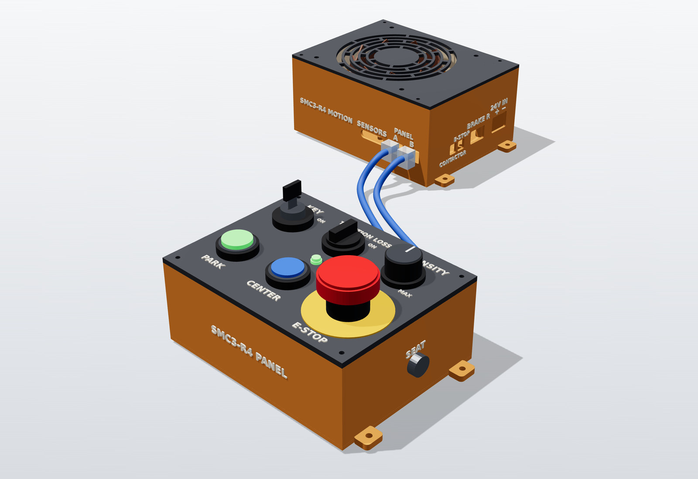

# Motion Shield (in the works)

A controller board for SMC3 R4: it plugs onto the Arduino UNO R4 WiFi and takes the place of the IBT-2 bridges, the
MAX3232 module and most of the loose wiring. A printed enclosure holds it with a 120 mm fan, and a separate control
box with 22 mm industrial controls connects to it with two ordinary network cables.

**It is a first prototype (board v0.8).** No board has been built or tested yet, and nothing has been printed, so
details may still change. The pictures are renders made from the design files - the board from its Gerber files,
the boxes from their STEP files - with the parts drawn as simple shapes.

## Why a board of its own

- **One board instead of a bundle of modules.** Three IBT-2 bridges, an RS-232 module, a separate supply for the
  Arduino and the wires between them become one board with labelled screw terminals and plugs.
- **Made for the motors these rigs use**: 24 V DC motors (wiper and wheelchair motors) at up to about 30 A each.
- **Safety in hardware.** The emergency stop and the key switch are loops: open either one and the motor drivers
  switch off in hardware, whatever the software is doing. There is also an output for a main power contactor.
- **The page can see more.** Motor currents, the supply voltage, the board temperature and the intensity knob are
  measured on the board.
- **Assembled by the board maker.** It is laid out for JLCPCB to assemble from the parts they stock, the
  through-hole parts included, so it should arrive nearly complete.

## On the board

| | |
|---|---|
| Motors | 4 outputs (three plus a spare). Each is a full bridge of four 60 V MOSFETs (BSC028N06NS) driven by a TI DRV8701, with a 1 mΩ current sense resistor, a 30 A blade fuse and 2 x 1000 µF. Screw terminals for up to 30 A. |
| Supply | 24 V in on a 65 A screw terminal, with TVS diodes. A brake chopper sends the energy of braking motors into an external brake resistor when the supply voltage rises. |
| The Arduino | Fed from the board's own 5 V switching regulator (LM2596HVS) through its 5 V pin, so its 5 V no longer sags on USB. |
| Safety | E-STOP and key loops that switch the drivers off in hardware (two jumpers bridge them when no panel is fitted); a contactor coil output. |
| Measured | Motor currents, supply voltage, intensity knob, board temperature (two ADS1115 converters). |
| Sensors | Four position sensor plugs (JST-XH), and the WT901C-232 motion sensor plug with the RS-232 chip (MAX3232) on the board. |
| Panel | Two RJ45 sockets for the control box: park and center buttons, the park button's 12 V light, emergency stop, key switch, traction loss switch, intensity knob, a status RGB LED and a seat switch. |
| Fan | A 4-pin PWM fan header with its own fan controller (EMC2301). Firmware 2.2.0 already runs it: Settings, Fan. |
| Spare | An I2C header and spare inputs. |
| The board | 4 layers, 160 x 110 mm, 2 oz outer copper recommended. |

## The enclosure

Two printed parts (PETG or ASA), 168 x 127 x 78 mm. A 120 mm 4-pin fan (a Noctua NF-A12x25 PWM here) hangs under
the lid and blows air in; it leaves through vents in the side and the connector windows. Every opening has a raised
label - M1-M4, 24V IN, BRAKE R, E-STOP, CONTACTOR, SENSORS, PANEL A / B, USB - and the terminal screws are reached
from above with the lid off. No supports needed.

## The control box

Also printed, 170 x 130 x 69 mm, for standard 22 mm industrial controls: PARK (lit), CENTER, E-STOP, a KEY switch, a
TRACTION LOSS switch, an INTENSITY knob, a STATUS light and a SEAT switch socket. It connects with two straight
Cat5e/Cat6 cables to keystone jacks in its back, so it can sit wherever it suits the driver.

## Firmware

Firmware 2.2.0 already runs the Motion Shield's fan (Settings, Fan). The rest - the panel's buttons and light, and
the current and voltage readings - comes once the first boards have been built and tested.
